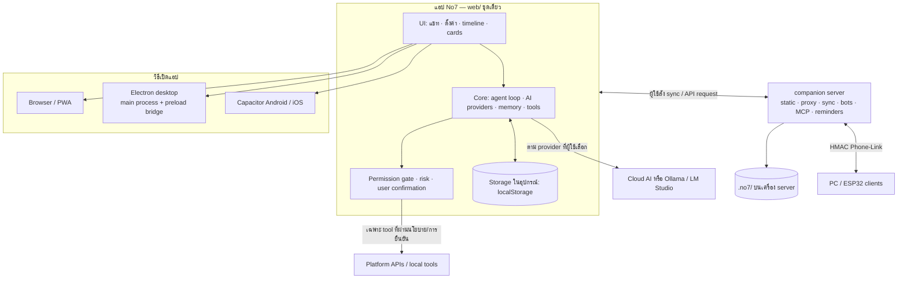
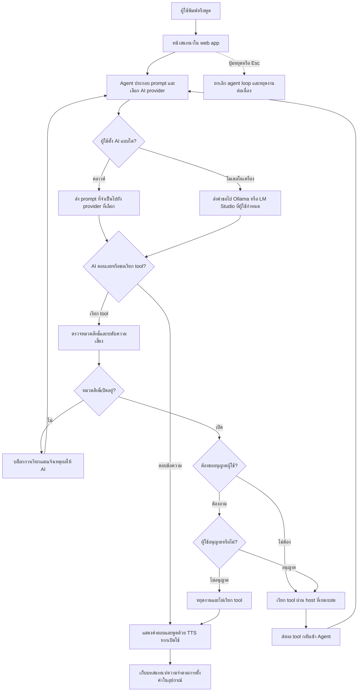
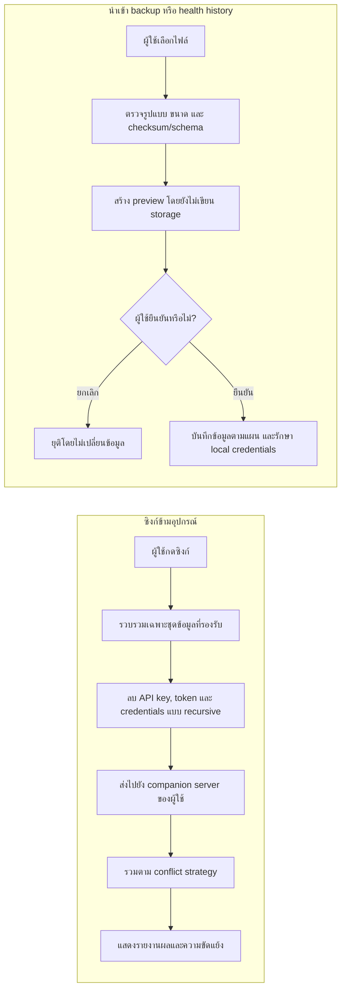

# No7 Personal AI Bot `v2.42`

> ผู้ช่วย AI ส่วนตัวที่ **โค้ดชุดเดียวกันรันได้ทั้งมือถือและ PC** — พูดไทยก่อน ฟังได้ด้วยเสียง มีความจำระยะยาว
> เรียกเครื่องมือจริง ทำงานหลายก้าวได้ ซิงก์ข้ามเครื่อง และสั่งงานอุปกรณ์ผ่าน HMAC
>
> หลอมหลักการของ [PersonalAIBot-ESP32](https://github.com/danaikointa-maker/PersonalAIBot-ESP32) และ
> [uncle-desktop](https://github.com/danaikointa-maker/uncle-desktop) แล้วเขียนใหม่ให้เป็นเว็บเทคโนโลยี

## สารบัญ

- [รุ่นล่าสุด](#รุ่นล่าสุด-v2422)
- [เริ่มต้นใช้งาน](#เริ่มต้นใช้งาน)
- [ฟีเจอร์หลัก](#ทำอะไรได้-v242)
- [แก้ปัญหาเบื้องต้นและดูแลข้อมูล](#แก้ปัญหาเบื้องต้นและดูแลข้อมูล)
- [สถาปัตยกรรมและ Flowcharts](#สถาปัตยกรรม-โครงสร้างระบบและการไหลของข้อมูล)
- [เอกสารรายฟีเจอร์](#เอกสาร)
- [ความเป็นส่วนตัว](#ความเป็นส่วนตัว)
- [สัญญาอนุญาต](#license)

---

## รุ่นล่าสุด v2.42.2

รุ่น [v2.42.2](https://github.com/danaikointa-maker/No7PersonalAIBot/releases/tag/v2.42.2) อัปเกรด Capacitor CLI/core/Android/iOS เป็น 8.6.0 พร้อม CI ตรวจสร้างและ sync โปรเจกต์ Android/iOS แยกกัน โดยไม่แนบ APK/IPA ใน release; ก่อนย้าย native project เดิมให้สำรองข้อมูลและอ่าน [คู่มือมือถือ](mobile/README.md) ก่อน รุ่น v2.42.1 ก่อนหน้านี้อัปเดต Electron และอุด critical tar advisory

เว็บและ companion server ใช้ Node.js 20 ขึ้นไป; Capacitor 8 ใช้ Node.js 22 ขึ้นไป และการพัฒนา/แพ็ก Electron ต้องใช้ Node.js 22.12 ขึ้นไป ส่วนผู้ใช้ติดตั้งแอปสำเร็จรูปไม่ต้องติดตั้ง Node.js

## เริ่มต้นใช้งาน

### ข้อกำหนดก่อนติดตั้ง

- Node.js **20 ขึ้นไป** และ npm (แนะนำ Node.js 22); Capacitor 8 ต้องใช้ Node.js 22 ขึ้นไป และการพัฒนา/แพ็ก Electron ต้องใช้ Node.js **22.12 ขึ้นไป**
- Git สำหรับ clone repository
- ใช้เว็บ/PWA ได้โดยไม่ต้องติดตั้งเครื่องมืออื่น; สร้างเดสก์ท็อปต้องใช้ Electron; Android ต้องมี Android Studio/SDK; iOS ต้องใช้ macOS และ Xcode

### ติดตั้งและเปิดเว็บ/PWA

```bash
git clone https://github.com/danaikointa-maker/No7PersonalAIBot.git
cd No7PersonalAIBot
npm ci
npm run dev
```

เปิด `http://localhost:5173` บนคอมพิวเตอร์ ค่าเริ่มต้นใช้ **Pollinations** โดยไม่ต้องใส่ API key; ปรับผู้ให้บริการ/ภาษา/เสียงได้ที่ ⚙️ ตั้งค่า ข้อมูลการตั้งค่าและความจำอยู่ใน storage ของ browser บนอุปกรณ์นั้น

ใช้ build สำหรับ production หรือ preview build ได้ด้วย:

```bash
npm run build       # สร้าง dist/ สำหรับ PWA, Electron และ Capacitor
npm run preview     # preview dist/ ที่ http://localhost:4173
```

ต้องการติดตั้ง PWA ให้เปิดเว็บผ่าน HTTPS แล้วเลือก “ติดตั้งแอป” ใน Chrome/Edge หรือ “เพิ่มไปยังหน้าจอโฮม” ใน Safari บน iOS การใช้ไมโครโฟนใน browser ต้องเป็น secure context (`https://` หรือ `localhost`); การเปิด IP ภายในบ้านผ่าน HTTP อาจถูก browser บล็อกไมโครโฟน

### ตั้งค่า AI และเริ่มใช้งาน

1. เปิดแอป แล้วไปที่ ⚙️ ตั้งค่า → เลือก provider: Pollinations (ไม่ต้องใช้ key), Gemini, OpenAI, Ollama หรือ OpenAI-compatible
2. ถ้า provider ต้องใช้ key ให้กรอกในช่อง API key ของตั้งค่า; สำหรับ Ollama ให้เปิด Ollama ในเครื่องและเลือก model/base URL ที่ใช้งานได้
3. กลับหน้าแชท เลือกโหมดหรือ “ทั้งหมด” แล้วพิมพ์/กดไมค์เพื่อถาม; หาก AI ขอเรียกเครื่องมือที่มีความเสี่ยง แอปจะแสดงหน้าต่างขออนุญาตก่อนทำงาน
4. ตั้งค่า TTS, persona, ความจำ, backup, sync หรือ connectors เพิ่มได้ตามต้องการ โดยแต่ละฟีเจอร์มีเอกสารเฉพาะด้านใน [docs](#เอกสาร)

**ข้อควรทราบ:** เมื่อเลือก provider บนคลาวด์ ข้อความสนทนาที่จำเป็นต่อคำขอจะถูกส่งไปยัง provider นั้นตามการตั้งค่าของผู้ใช้ อย่าใส่ข้อมูลที่ไม่ต้องการส่งออก; API key ใน browser เก็บใน storage ของอุปกรณ์นี้ แต่ต้องถือว่าเข้าถึงได้โดยผู้ใช้เครื่องเดียวกัน

### ใช้ companion server (ไม่บังคับ)

Server ใช้เสิร์ฟ `dist/`, proxy บาง API, ซิงก์ข้อมูล, Phone-Link, reminders, bots และ MCP stdio ตามการตั้งค่าของผู้ดูแล:

```bash
npm run build
NO7_SYNC_TOKEN='ใส่ค่าสุ่มยาวและเก็บเป็นความลับ' npm run server
```

ค่าเริ่มต้นฟังที่ `0.0.0.0:8787`; ตรวจสุขภาพบริการได้ที่ `http://localhost:8787/api/health` และเปิดเว็บที่ `http://localhost:8787` หากเปิดให้เครื่องอื่นเข้าถึง ต้องจำกัดใน LAN หรือวางหลัง HTTPS/reverse proxy พร้อม firewall และตั้ง `NO7_SYNC_TOKEN` ก่อนใช้ sync — หากไม่ตั้ง token endpoint sync จะไม่มีการยืนยันตัวตนตามที่ server แจ้งเตือน ข้อมูลซิงก์เก็บใน `.no7/` (เปลี่ยนที่เก็บได้ด้วย `NO7_DATA_DIR`) อย่าเปิดโฟลเดอร์นี้ให้สาธารณะหรือ commit เข้า Git

ตัวแปร server ที่ใช้บ่อย: `NO7_PORT`, `NO7_HOST`, `NO7_DATA_DIR`, `NO7_SYNC_TOKEN`, `GEMINI_API_KEY`, `OPENAI_API_KEY`, `OLLAMA_URL`, `TELEGRAM_BOT_TOKEN`, `TELEGRAM_WEBHOOK_SECRET`, `LINE_CHANNEL_ACCESS_TOKEN`, `LINE_CHANNEL_SECRET`, `MCP_STDIO_SERVERS` ดูรายละเอียดการตั้งค่าใน [docs/BUILD.md](docs/BUILD.md), [docs/BOTS.md](docs/BOTS.md), [docs/MCP.md](docs/MCP.md) และ [docs/SYNC.md](docs/SYNC.md)

### แอปเดสก์ท็อปและมือถือ

```bash
npm run desktop          # build แล้วเปิดแอป Electron
npm run desktop:dev      # ใช้คู่กับ npm run dev ที่เปิดค้างไว้อีก terminal
npm run desktop:dist     # สร้าง installer ของ OS ปัจจุบันใน release/

npm run mobile:add:android  # ครั้งแรก: เพิ่ม native Android project
npm run mobile:sync         # build และ sync ไปยังโปรเจกต์ Capacitor
npm run mobile:open:android # เปิด Android Studio
```

iOS ต้องใช้ macOS + Xcode: รัน `npm run mobile:add:ios`, `npm run mobile:sync`, แล้ว `npx cap open ios` การสร้าง native project เป็นขั้นตอนครั้งแรก; Android/iOS project อาจต้องตั้ง signing และสิทธิ์ไมโครโฟนตามคู่มือแพลตฟอร์ม ตัวติดตั้ง macOS จาก CI เป็น unsigned build; macOS อาจต้องให้ผู้ใช้ยืนยันการเปิดแอปจากผู้พัฒนาที่ไม่รู้จัก

### ตรวจสอบโค้ด

```bash
npm test              # 512 tests (unit + integration)
npm run test:browser  # 205 browser-flow checks ใน jsdom
npx playwright install chromium # ครั้งแรก: เตรียมเบราว์เซอร์สำหรับ E2E
npm run test:e2e      # real Chromium E2E (แชทใช้ mock AI ไม่เรียกบริการจริง)
npm run check         # syntax + structure check
npm run build         # production build
npm run perf          # performance budget ของ source/bundle
```

### แก้ปัญหาเบื้องต้นและดูแลข้อมูล

| อาการ | วิธีตรวจสอบ/แก้ไข |
|---|---|
| เปิดไมค์ไม่ได้ | ใช้ `localhost` หรือ HTTPS, อนุญาตไมโครโฟนทั้งใน browser และระบบปฏิบัติการ; การเปิด IP ใน LAN ผ่าน HTTP อาจไม่ใช่ secure context |
| AI ไม่ตอบหรือแจ้งคีย์ผิด | ตรวจ provider, model และ API key ใน ⚙️ ตั้งค่า; ถ้าใช้ Ollama ให้ตรวจว่า service และ model ที่เลือกทำงานอยู่ หากใช้คีย์จาก companion server ให้ตรวจ environment variable แล้วเริ่ม server ใหม่ |
| ซิงก์ไม่ถึง server | ตรวจว่า client เข้าถึง host/port ได้ และ `NO7_SYNC_TOKEN` ที่ตั้งในแอปตรงกับ server; ห้ามเปิด server สู่สาธารณะโดยไม่มี token และ HTTPS/firewall |
| หน้าเว็บไม่อัปเดตหลัง deploy | ลอง reload แบบไม่ใช้ cache หรือปิด/เปิดแอปใหม่; อย่าล้าง site data/local storage หากยังไม่ได้ export backup เพราะข้อมูลในเครื่องอาจถูกลบ |
| ย้ายเครื่องหรือจะล้างข้อมูล | สร้างและตรวจไฟล์ backup จากหน้าแอปก่อน; backup เป็นไฟล์ที่ผู้ใช้ดาวน์โหลดเอง ส่วน sync จะส่งข้อมูลหลังผู้ใช้กดเท่านั้นและ redact secrets ก่อนส่ง; ประวัติสุขภาพส่งออกเฉพาะ summary metrics |
| แอปเดสก์ท็อปเปิดไม่ได้ | ติดตั้ง dependencies ด้วย `npm ci` ปกติ (อย่าใช้ `--ignore-scripts` เมื่อต้องรัน Electron) แล้วลอง `npm run desktop`; ดูรายละเอียด installer และระบบที่รองรับใน [docs/BUILD.md](docs/BUILD.md) |

---

## รุ่น 2.42.0: ปกป้องความลับเมื่อซิงก์และสำรองข้อมูล

- ก่อนสร้างชุดข้อมูลซิงก์ ระบบลบค่า API key, token, OAuth client secret, Authorization/cookie header และข้อมูลรับรองใน URL แบบซ้อนทุกระดับออก โดยยังเก็บค่ากำหนดทั่วไปที่ไม่ใช่ความลับไว้
- การส่งชุดซิงก์ไปยัง companion server ยังเริ่มจากผู้ใช้เท่านั้น ไม่มีการอัปโหลดข้อมูลสุขภาพหรือข้อมูลส่วนตัวโดยอัตโนมัติ
- ไฟล์สำรองจะไม่รวม secrets เป็นค่าเริ่มต้น; เมื่อนำไฟล์ที่ถูกปกปิด secrets กลับมาใช้ ระบบจะรักษา credentials ของเครื่องนี้สำหรับรายการตั้งค่าที่จับคู่กัน แทนการเขียนค่าว่างทับ

## ทำอะไรได้ (v2.42)

### 🎭 เลือกได้ทั้งหมด — 5 บทบาทในที่เดียว
`✨ ทั้งหมด` (สลับบทบาทเองตามคำขอ) · `💛 เพื่อนคุย` · `💼 งาน` · `📅 ชีวิตประจำวัน` · `🏠 อุปกรณ์`
แต่ละโหมดกรองเครื่องมือและปรับน้ำเสียง — เลือกโหมดเดียวหรือใช้ "ทั้งหมด" ก็ได้

### 🤖 ลงมือทำได้จริง (agent loop + ประตูอนุญาต)
- เรียกเครื่องมือต่อเนื่อง 1–8 ขั้นต่อคำสั่ง แล้วสรุปผลเป็นภาษาพูด
- ทุกการกระทำมีความเสี่ยง 0–3 → `อ่าน` ผ่านฉลุย · `ทำงานเบา/ร่างข้อความ/ควบคุมเครื่อง` ต้องยืนยัน
- กล่องยืนยันมี `อนุญาต` · `อนุญาตตลอด session` · `ไม่อนุญาต` และระดับอิสระ 3 แบบ
- 6 หมวดสิทธิ์ที่ปิดได้: 📖 อ่าน · 🧠 ความจำ · ⚡ ทำงานในเครื่อง · ✉️ ร่างข้อความ · 🎛️ ควบคุมอุปกรณ์ · 🔌 MCP

### 🧠 ความจำที่โตขึ้น
- BM25 (k1=1.2, b=0.5) × importance × recency × pin — ตัดคำไทยเป็น bigram, strip tone mark
- Consolidation: heuristic + AI (opt-in) สรุปบทสนทนาเป็นข้อเท็จจริง, merge ซ้ำ, decay ของเก่า, รายวัน
- ปักหมุด/แก้/ลบ/ค้น/กรอง/นำเข้า-ส่งออก JSON

### 🔊 เสียงและการตอบ
- สตรีมคำตอบทีละคำ (SSE/NDJSON) + **เริ่มพูดก่อนคำตอบจบ** แล้วหยุดทันทีถ้าเป็นการเรียกเครื่องมือ
- ฟังด้วยเสียงไทย (STT) + **ปลุกด้วยคำว่า "No7"** (หยุดฟังขณะพูด กันเสียงตัวเอง)
- **พูดขัดจังหวะได้ (barge-in)**: โหมด `keyword` ("หยุด/เดี๋ยว/รอ/stop") หรือ `any` พร้อมกันเสียงสะท้อนของตัวเอง
- **TTS 4 เจ้า**: เสียงเครื่อง (ฟรี/ออฟไลน์) · OpenAI-compatible · **ElevenLabs** (`eleven_multilingual_v2`) · ปิดเสียง
  พร้อม **แคชเสียงในหน่วยความจำ** (20 คลิป / 5 MB) — เล่นซ้ำทันที ไม่เสียโควตา
  ถ้าผู้ให้บริการล่มจะ fallback ไปเสียงเครื่องให้อัตโนมัติ
- ปรับความเร็ว/pitch/เลือกเสียง, ปุ่มหยุดพูด, คำบรรยายใต้จอ, อวาตาร์ 14 อารมณ์

### 🔌 MCP / เครื่องมือภายนอก
- ต่อ MCP server (JSON-RPC 2.0 over HTTP) ได้เอง — Gmail, ปฏิทิน, ไฟล์, ฐานข้อมูล
- **stdio ในเครื่อง**: companion server spawn MCP process ตาม allowlist `MCP_STDIO_SERVERS` (ไม่ให้เบราว์เซอร์สั่งรันคำสั่งเอง)
- **OAuth 2.0 + PKCE**: ล็อกอิน Gmail/Drive ได้จากหน้าตั้งค่า, ต่ออายุ token อัตโนมัติ, token อยู่ในเครื่องเท่านั้น
- เครื่องมือที่ค้นพบกลายเป็น `mcp__<server>__<tool>` ใช้ผ่าน agent loop และประตูอนุญาต (หมวด `mcp`, risk 2 = ถามก่อน)

### 💬 บอทแชท (Telegram / LINE)
- Telegram webhook (ตรวจ secret token) + LINE webhook (ตรวจ `X-Line-Signature` แบบ constant-time)
- จำบริบทต่อห้อง 16 ข้อความ (TTL 2 ชม.) + คำสั่ง `/start` `/help` `/clear` `/tools`
- token/secret อยู่ที่ server เท่านั้น — หน้าเว็บแค่แสดงสถานะและคัดลอก webhook URL

### 🖥️ ควบคุมคอมพิวเตอร์ (เดสก์ท็อป)
- tool `control_run` (risk 3) เปิดโปรแกรม/ลิงก์ คัดลอกข้อความ หรือรันคำสั่ง — **ปิดไว้เป็นค่าเริ่มต้น**
- allowlist แบบ glob 3 ชั้น: permission gate → policy ในเบราว์เซอร์ → main process (`NO7_CONTROL_ALLOW_COMMANDS`)
- deny patterns (rm -rf, sudo, curl|sh …), ปฏิเสธ shell operator, จำกัดต่อนาที + audit log

### ✅ งาน + เตือนข้ามเครื่อง
- เพิ่มงานด้วยเสียง/ข้อความ ("เตือนส่งรายงานพรุ่งนี้ 9 โมง"), priority 0–3, เตือนตามเวลา
- ซิงก์ข้ามเครื่องแบบ conflict-aware (newest / prefer-local / prefer-remote / keep-both) + รายงานความขัดแย้ง + tombstone (การลบตามไปทุกเครื่อง) รวมเตือนความจำที่ตั้งในเครื่อง
- `parseDue` เข้าใจ ISO, `+30m`, `+2h`, `วันนี้ 18:00`, `พรุ่งนี้ 09:30`

### 🧩 ผลลัพธ์ทยอยขึ้นระหว่างทำงาน
- ทำงานหลายเครื่องมือในคำสั่งเดียว: การ์ดของแต่ละเครื่องมือขึ้นทันทีที่ได้ผล (ไม่ต้องรอคำตอบจบ)
- ระหว่างลูปบอก `กำลังสรุป…` แล้วคำตอบสุดท้ายมาเติมโดยไม่ทิ้งการ์ดที่วาดแล้ว

### 📆 รายงานรายสัปดาห์
- ปิดงานได้กี่อย่าง · เพิ่มใหม่เท่าไร · นัดหมาย · ความจำใหม่ · เครื่องมือที่ใช้บ่อย + failure rate
- เทียบกับสัปดาห์ก่อน และมีข้อเสนอโฟกัสสัปดาห์หน้า (tool `weekly` ให้ AI เรียกเองได้)

### 🔎 ค้นทุกอย่างด้วย ⌘K
- command palette เดียวค้น ความจำ · โน้ต · รายการ · งาน · นัดหมาย · เครื่องมือ · เมนู · คำสั่ง
- ↑↓/Enter/Esc, ไฮไลตคำค้น, เลือกแล้วไปถูกที่ (เช่น ค้นความจำ → เปิดหน้าความจำพร้อมคำค้น)

### 💾 สำรอง/กู้คืนที่ตรวจสอบได้
- ไฟล์สำรอง schema 2 + checksum รวม chat log และ health summary ที่เก็บทั้งหมดตามเพดานไฟล์ 20 MiB; ไม่ prune facts/log/health summary เก่าอัตโนมัติ; archive อ่าน/ค้นหา/กรองตามวันพร้อม paging ได้ครบ; **ตัด API key/token ออกเป็นค่าเริ่มต้น**
- นำเข้าแบบ dry-run: บอกก่อนว่าจะเพิ่ม/อัปเดตกี่รายการ แล้ว merge แบบ last-write-wins; ปฏิเสธไฟล์เกิน 20 MiB/collection ผิดรูปก่อนเขียน และรักษา credentials ในเครื่องเมื่อไฟล์ถูก redacted

### 🧭 เห็นทุกขั้น — และหยุดได้จริง
- แผง timeline สด ๆ บอกว่า No7 กำลังคิดขั้นไหน เรียกเครื่องมืออะไร เสร็จแล้วหรือยัง (พร้อม ms)
- ปุ่ม ⏹ / `Esc` = ยกเลิกงานกลางทาง + หยุดเสียงทันที (ไม่เรียกเครื่องมือเพิ่มหลังสั่งหยุด)

### 🌅 สรุปประจำวัน
- รวมงานเกินกำหนด/ครบวันนี้/นัดหมาย/งานถัดไป/ความจำใหม่ ในการ์ดเดียว หรือ Ask No7 ก็ได้ (tool `digest`)
- เปิด "สรุปอัตโนมัติทุกเช้า" ให้ขึ้นเองครั้งแรกของวันหลัง 07:00

### 🧩 ปลั๊กอินเครื่องมือของตัวเอง
- ประกาศเครื่องมือ HTTP ด้วย JSON (GET/POST, `{{param}}`, headers, body) → ใช้ได้ทันทีทั้งกับ AI และกดทดลอง
- ปลอดภัยตั้งแต่ต้น: https เท่านั้น, บล็อก localhost/วง LAN, timeout 10 วิ, จำกัด 64 KB, risk ≥ 1 ต้องยืนยัน

### 🧠⚡ สมองในเครื่อง (ออฟไลน์ได้จริง)
- ต่อ **Ollama** หรือ **LM Studio** ที่เครื่องตัวเอง (LAN) — สแกนรุ่นที่มี ตรวจว่าพร้อม แล้วเลือกตัวที่เหมาะ
- ตั้ง chain อัตโนมัติ: ออนไลน์ใช้คลาวด์ → เน็ตหลุดสลับเป็นรุ่นในเครื่องทันที (โหมด `private`, ไม่มีคีย์)
- server proxy `/api/local-models` + `/api/local-models/warm` พร้อม guard กัน SSRF (เฉพาะ LAN/localhost)

### 🌐 สองภาษา ไทย/อังกฤษ
- สลับภาษาหน้าจอได้ทันทีโดยไม่กระทบภาษาที่ AI ตอบ (`uiLang` ≠ `language`)
- ~90 จุดใน UI ผ่าน `data-i18n` + `applyI18n()` — เพิ่มภาษาใหม่ได้ด้วยการเพิ่มพจนานุกรมชุดเดียว

### 📦 คุณภาพที่วัดได้
- `npm run perf` = performance budget จริง (source + gzip bundle) ทำงานใน CI ทุก PR
- jsdom browser smoke 205 checks ครอบเส้นทางหลัก; Playwright/Chromium จริงตรวจ boot/แชท, permission ปฏิเสธ/อนุญาต/จำสิทธิ์, capability report เมื่อ API เสียงไม่พร้อม/ปฏิเสธไมค์, คิวออฟไลน์ที่ลบได้เมื่อผู้ใช้ยืนยันและส่งอัตโนมัติเมื่อกลับมาออนไลน์ รวมถึง backup restore ที่ไม่เขียน storage เมื่อยกเลิกและเขียนหลังยืนยันเท่านั้น; CI ตรวจ capability report เพิ่มใน Chromium/Firefox/WebKit (mock AI; timer อยู่ใน test context)
- ทุก PR build และตรวจเนื้อหา Linux `.deb` จริง พร้อม upload/download round-trip ตรวจ SHA-256; CI ยังมี synthetic action check ส่วน release workflow ตรวจ checksum installer จริงทั้ง 3 OS และความถูกต้องของ updater metadata ก่อนเผยแพร่ (ด่านสาม OS จะรันเมื่อออก release/tag ไม่ใช่ทุก PR)

### 🔄 อัปเดตเวอร์ชัน (opt-in)
- เดสก์ท็อปแอปเช็คอัปเดตเองเมื่อเปิด `NO7_AUTO_UPDATE=1` (แจ้งเตือนเมื่อมีใหม่, ติดตั้งตอนปิดแอป)
- `git tag v2.0.0` → GitHub Actions build Windows (`.exe`), macOS (แอป `.zip`) และ Linux (`.deb`) พร้อม metadata `latest*.yml`; การสร้าง release เป็น draft หรือเผยแพร่ทันทีขึ้นกับวิธี trigger

### 🧯 ความเสถียรและความเร็ว
- Retry แบบ exponential + jitter เฉพาะ error ชั่วคราว (429/5xx/network) และไม่ลองซ้ำถ้าเริ่มพูดไปแล้ว
- **คิวออฟไลน์**: พิมพ์ตอนไม่มีเน็ตแล้วเก็บไว้ ส่งอัตโนมัติเมื่อกลับมาออนไลน์
- สถิติในเครื่อง: token แรก, เวลารวม, เวลาต่อเครื่องมือ, p50/p95, อัตราสำเร็จ
- **รายงานปัญหาแบบปิดข้อมูลอ่อนไหว** (key/token/อีเมล/เบอร์โทร) คัดลอกหรือดาวน์โหลด `.md` ได้

### 📱 มือถือ
- PWA shortcuts (`?view=chat|memory|calendar|devices`), แถบออฟไลน์, แผงความสามารถ 15 อย่าง
- จัดการพื้นที่เก็บข้อมูล + ขอ persistent storage + ล้างข้อมูลเป็นกลุ่ม
- เมนู/ปุ่มใหญ่/ปุ่มลัดคีย์บอร์ด (`Ctrl/Cmd+K`, `Ctrl/Cmd+M`, `Esc`, `Ctrl/Cmd+Enter`)

### 🧰 30 tools (28 เดิม + `digest` + `weekly`) — ไม่ต้องใช้คีย์
| หมวด | tools |
|---|---|
| 📖 อ่าน | `weather` `air` `crypto` `fx` `gold` `wiki` `news` `calc` `rss_read` `summarize_url` |
| 🧠 ความจำ | `memory_save` `memory_search` `todo` `note` |
| 📅 ตาราง | `calendar_list` `calendar_add` (+ นำเข้า/ส่งออก `.ics`) |
| ⚡ ทำงานในเครื่อง | `timer` `reminder` `clipboard_copy` `open_url` `task` |
| ✉️ ร่างข้อความ | `compose_message` (อีเมล/SMS/LINE — คุณกดส่งเอง) |
| 🎛️ ควบคุม | `open_app` `control_run` `desktop` `run_recipe` `device_command` `system_info` |
| 🌅 สรุป | `digest` `weekly` (dynamic) — ปลั๊กอินผู้ใช้กลายเป็น `plugin__<id>` เพิ่มได้เอง |

### 🎭 Persona Studio
สร้าง/แก้/ทำสำเนา/ลบ persona เอง — ตัวตน, คำทักทาย, หัวข้อต้องห้าม, คำลงท้าย, สไตล์เสียง

### 🔗 อุปกรณ์ + 🔄 ซิงก์
- Phone-Link: สั่งงาน PC/ESP32 ผ่าน HMAC-SHA256 (`/api/link/*`), มี ESP32 reference client ให้
- ซิงก์มือถือ ↔ PC ผ่าน server ของคุณเอง (`/api/sync`, token) — ไม่มีคลาวด์ ไม่มีบัญชี
- เลือกกลยุทธ์เมื่อข้อมูลชนกัน + ดูรายงาน "เพิ่ม/อัปเดต/คงเดิม/ชนกัน" (ดู [docs/SYNC.md](docs/SYNC.md))
- ส่งออกสรุปวันนี้/รายงานสัปดาห์เป็น Markdown หรือ CSV (BOM พร้อม Excel ไทย) — [docs/REPORTS.md](docs/REPORTS.md)
- ตรวจสุขภาพข้อมูล (คะแนน A–D), ล้างแบบยืนยันและย้อนกลับได้ใน 30 วินาที, ดูแนวโน้ม 7/30 วันและส่งออก/นำเข้าประวัติ JSON พร้อม preview ก่อน merge; CSV/Markdown/JSON; เก็บเฉพาะสรุป ไม่เก็บข้อความส่วนตัว — [docs/HEALTH.md](docs/HEALTH.md)
- **งาน + เตือนข้ามเครื่อง**: เพิ่มงานด้วยเสียง/ข้อความ, เตือนตามเวลา, ซิงก์แบบ last-write-wins (tombstone สำหรับการลบ)
- **งานซ้ำ + เตือนแม้ปิดแอป**: `daily/weekdays/weekly/monthly/hourly`, server tick ส่ง Telegram, ปิดงานแล้วเลื่อนรอบถัดไปเอง

### 🖥️ เดสก์ท็อป
tray · hotkey ระดับระบบ (`Ctrl/Cmd+Shift+Space`) · overlay always-on-top · clipboard/open-app/notify bridge
- **รู้จักหน้าต่างบนจอ**: อ่านรายชื่อหน้าต่าง (powershell / osascript / wmctrl) + ค้นหา + โฟกัส
- **สูตรอัตโนมัติ (recipes)**: ลำดับขั้น `open_app` / `open_url` / `focus_window` / `wait` / `notify` สูงสุด 8 ขั้น, dry-run ได้, วิ่งผ่าน allowlist เดิม

---

## สถาปัตยกรรม: โครงสร้างระบบและการไหลของข้อมูล

หลักการคือ **แอปและ business logic อยู่ใน `web/` ชุดเดียว** แล้วนำไปใช้ผ่าน host ที่เหมาะกับแต่ละอุปกรณ์ ไม่ทำสำเนา logic แยกในเว็บ, Electron และ Capacitor ส่วน companion server เป็นบริการเสริมที่ผู้ใช้โฮสต์เอง ไม่จำเป็นสำหรับการทดลองใช้หน้าเว็บ



แผนภาพด้านบนแสดง **องค์ประกอบและการเชื่อมต่อระหว่างแอปกับบริการเสริม**; แผนภาพต่อไปแสดงลำดับการทำงานจริงเมื่อผู้ใช้ส่งคำถามและเมื่อมีการซิงก์/นำเข้าข้อมูล

### Flowchart: การตอบคำถามและเรียกใช้เครื่องมือ



### Flowchart: ซิงก์และนำเข้าข้อมูลโดยผู้ใช้เป็นผู้ควบคุม



**ขอบเขตข้อมูล:** ซิงก์เริ่มจากการกระทำของผู้ใช้และมีการ redact secrets ก่อนส่ง; health history เก็บ/ส่งออกเฉพาะ summary metrics และไม่มี auto-upload ส่วนการนำเข้าไฟล์จะไม่เขียน storage ก่อนผู้ใช้ยืนยัน ดูรายละเอียด [docs/SYNC.md](docs/SYNC.md), [docs/BACKUP.md](docs/BACKUP.md) และ [docs/HEALTH.md](docs/HEALTH.md)

### เส้นทางคำขอและขอบเขตความปลอดภัย

1. ข้อความจากผู้ใช้เข้าสู่ agent loop; AI สร้างคำตอบหรือคำขอเรียก tool
2. แอปตรวจหมวดสิทธิ์และ risk ของ tool ก่อนเรียกใช้; งานที่ต้องยืนยันจะหยุดรอผู้ใช้ และปุ่มหยุดยกเลิกลูปได้
3. core เรียก API ของ provider ที่เลือก และเก็บความจำ/การตั้งค่าใน storage ของอุปกรณ์ ไม่ต้องมีบัญชี No7 หรือคลาวด์กลาง
4. การใช้ companion server เป็นทางเลือก: client ติดต่อ server ที่ผู้ใช้ดูแลสำหรับ API บางประเภท, sync, bots, MCP bridge, reminders และ Phone-Link
5. sync เริ่มจากผู้ใช้; secrets ถูก redact ก่อนสร้าง sync bundle; ประวัติสุขภาพมีเฉพาะ summary metrics และไม่อัปโหลดเอง การนำเข้า backup/history ต้องเริ่มและยืนยันโดยผู้ใช้ก่อนเขียน storage

| ส่วนประกอบ | หน้าที่ | จุดเริ่มต้นใน repo |
|---|---|---|
| Web app | UI, agent loop, providers, permissions, tools, memory, backup/sync | `web/index.html`, `web/src/main.js`, `web/src/core/` |
| Desktop host | หน้าต่าง Electron, tray, global shortcut, overlay และ IPC ที่จำกัดขอบเขต | `desktop/main.js`, `desktop/preload.cjs` |
| Mobile host | Capacitor wrapper; ใช้ web build เดียวกัน | `capacitor.config.json`, `mobile/` |
| Companion server | static server และ API สำหรับ AI proxy, sync, device link, reminders, bots, MCP/OAuth | `server/server.js`, `server/bots.js` |
| Device reference | HMAC Phone-Link client สำหรับ ESP32 | `devices/esp32/` |
| Build/test | Vite, release workflow, unit/integration/browser tests | `vite.config.js`, `.github/workflows/`, `tests/` |

### โครงสร้าง repository

```text
web/
  index.html, overlay.html, src/main.js, src/overlay.js, src/styles.css
  src/core/       agent, AI providers, permissions, tools, memory, voice,
                  backup/restore, sync, tasks, calendar, MCP, OAuth, health, metrics…
  src/ui/         cards, archive และ UI controllers ที่แยกไว้
  public/         icon และ static assets
 desktop/         Electron main process, preload bridge, updater
 mobile/          โฟลเดอร์รองรับ native project ของ Capacitor
 server/          companion server, bots และ atomic file writes
 devices/esp32/   Phone-Link reference client
 build/           ไอคอนสำหรับ installer ของ macOS/Windows/Linux
 tests/           node:test, server integration, jsdom smoke และ Playwright E2E (`tests/e2e/`)
 docs/             คู่มือฟีเจอร์/โปรโตคอล/การ build
 tools/            check และ performance-budget scripts
```

**หลักการแบ่งชั้น:** `web/src/core/` ทำงานหลักโดยไม่พึ่ง Node/Electron; `desktop/` ใช้ main process/preload เป็นสะพานเฉพาะ capability ของ desktop; `server/` ทำงานเป็น process แยก; `devices/` เป็น client reference สำหรับ protocol ไม่ใช่ส่วนที่ต้องใช้เพื่อเปิดแอปทั่วไป อ่านรายละเอียดเพิ่มเติมได้ที่ [docs/ARCHITECTURE.md](docs/ARCHITECTURE.md) และ [docs/BUILD.md](docs/BUILD.md)

## เอกสาร

| ไฟล์ | เนื้อหา |
|---|---|
| [docs/ARCHITECTURE.md](docs/ARCHITECTURE.md) | โครงสร้าง, state machine, permission gate, data flow |
| [docs/PRINCIPLES.md](docs/PRINCIPLES.md) | หลักการจาก repo เดิม → อยู่ตรงไหนในโค้ดนี้ |
| [docs/PHASES.md](docs/PHASES.md) | แผนเฟสและสถานะการปิดงาน |
| [docs/ROADMAP.md](docs/ROADMAP.md) | ลำดับงานที่เหลือและเงื่อนไขตรวจรับ |
| [docs/MEMORY.md](docs/MEMORY.md) | ความจำ BM25 + consolidation |
| [docs/VOICE.md](docs/VOICE.md) | สตรีมมิ่ง, พูดก่อนจบ, wake word |
| [docs/PERSONA.md](docs/PERSONA.md) | Persona Studio |
| [docs/CONNECTORS.md](docs/CONNECTORS.md) | ปฏิทิน, RSS, sync |
| [docs/MCP.md](docs/MCP.md) | MCP client, stdio bridge, proxy, สิทธิ์, ข้อจำกัด |
| [docs/OAUTH.md](docs/OAUTH.md) | OAuth 2.0 + PKCE, token store, ความปลอดภัย |
| [docs/MOBILE.md](docs/MOBILE.md) | PWA, offline, capability, storage บนมือถือ |
| [docs/RELIABILITY.md](docs/RELIABILITY.md) | retry/backoff, offline queue, metrics, diagnostics |
| [docs/BOTS.md](docs/BOTS.md) | Telegram / LINE bot ผ่าน server |
| [docs/CONTROL.md](docs/CONTROL.md) | computer control + allowlist + audit |
| [docs/TASKS.md](docs/TASKS.md) | งาน, งานซ้ำ, เตือนตามเวลา + เตือนผ่าน server/Telegram |
| [docs/DESKTOP.md](docs/DESKTOP.md) | หน้าต่างบนจอ + สูตรอัตโนมัติ (recipes) |
| [docs/LOCAL_MODELS.md](docs/LOCAL_MODELS.md) | สมองในเครื่อง (Ollama / LM Studio) + สลับอัตโนมัติเมื่อออฟไลน์ |
| [docs/I18N.md](docs/I18N.md) | สองภาษา ไทย/อังกฤษ (สลับหน้าจอได้ทันที) |
| [docs/DEVICES.md](docs/DEVICES.md) | Phone-Link protocol + ESP32 |
| [docs/PHONE_LINK.md](docs/PHONE_LINK.md) | HMAC canonical signing + ตัวอย่าง curl |
| [docs/WEEKLY.md](docs/WEEKLY.md) | รายงานรายสัปดาห์ + ข้อเสนอโฟกัส |
| [docs/SYNC.md](docs/SYNC.md) | ซิงก์ conflict-aware: กลยุทธ์, คีย์, รายงานความขัดแย้ง |
| [docs/REPORTS.md](docs/REPORTS.md) | ส่งออกสรุปวันนี้/รายงานสัปดาห์เป็น Markdown หรือ CSV |
| [docs/HEALTH.md](docs/HEALTH.md) | ตรวจสุขภาพข้อมูลและล้างรายการซ้ำ/ว่างอย่างปลอดภัย |
| [docs/SEARCH.md](docs/SEARCH.md) | command palette ⌘K + การให้คะแนน/ไฮไลต์ |
| [docs/BACKUP.md](docs/BACKUP.md) | สำรอง/กู้คืน schema 2 (dry-run, merge/replace) |
| [docs/AGENT.md](docs/AGENT.md) | agent loop, event, timeline, การหยุดกลางทาง |
| [docs/DIGEST.md](docs/DIGEST.md) | สรุปประจำวัน + การแจ้งเตือนอัตโนมัติ |
| [docs/PLUGINS.md](docs/PLUGINS.md) | ปลั๊กอินเครื่องมือ HTTP (JSON) + ความปลอดภัย |
| [docs/QUALITY.md](docs/QUALITY.md) | performance budget + E2E + integration tests |
| [docs/BUILD.md](docs/BUILD.md) | build ทั้ง 3 แพลตฟอร์ม + release/auto-update |
| [docs/CONCEPT.md](docs/CONCEPT.md) | คอนเซ็บผู้ใช้ → สเปก |
| [CHANGELOG.md](CHANGELOG.md) | ประวัติเวอร์ชัน |

## ความเป็นส่วนตัว

ทุกอย่างเก็บในเครื่อง (ความจำ, ตั้งค่า, โน้ต, ปฏิทิน, persona, อุปกรณ์)
API key ไม่ถูกส่งออก ไม่ถูกซิงก์ และไม่เคยออกจากเครื่องนอกจากไปยังผู้ให้บริการ AI ที่คุณเลือก
การซิงก์/สั่งงานอุปกรณ์ใช้ server ที่คุณโฮสต์เองในวง LAN

## License

MIT — ดู [LICENSE](LICENSE)
