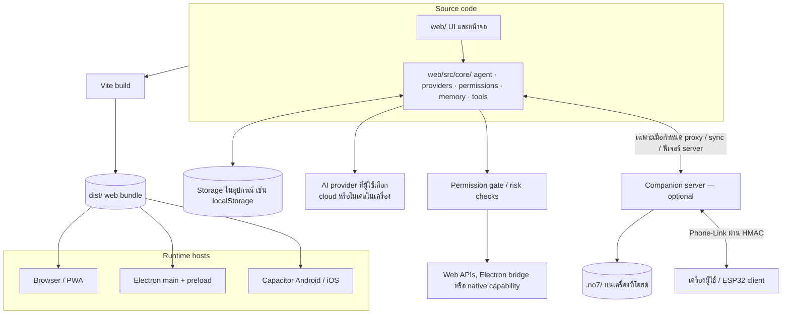
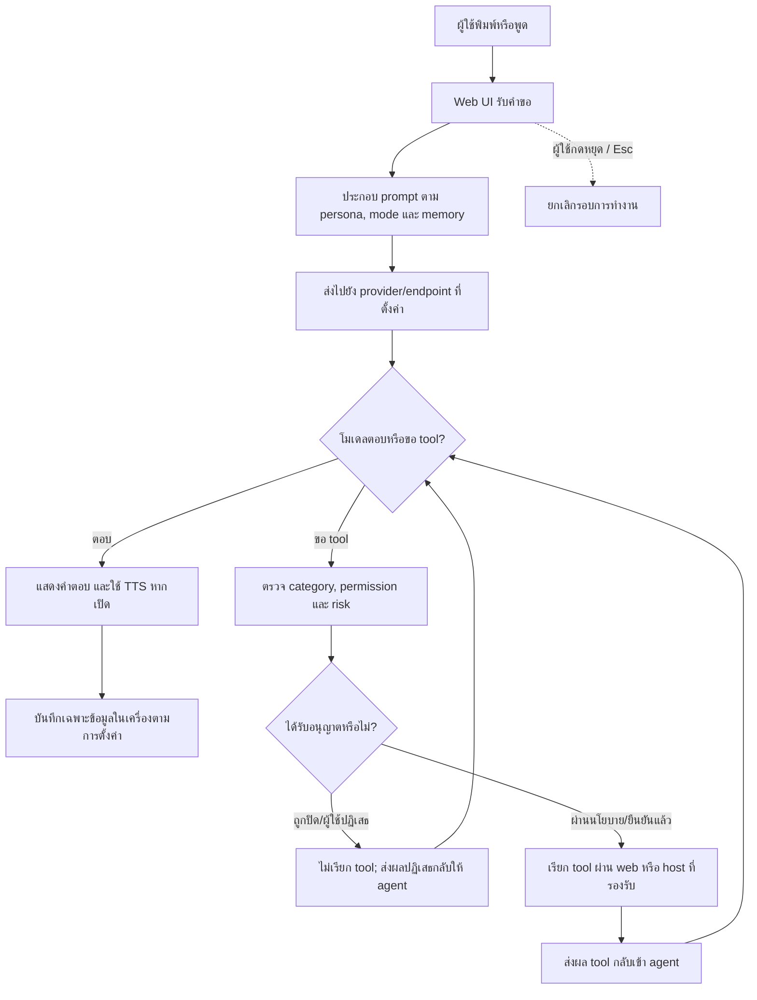
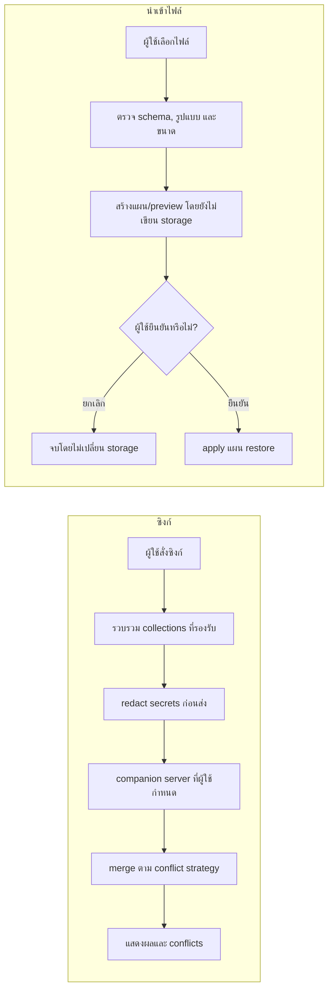

# สถาปัตยกรรม — No7 Personal AI Bot v2.42.2

เอกสารนี้อธิบายโครงสร้างปัจจุบันของ repository และขอบเขตที่ยืนยันได้จากโค้ด/CI รุ่นแอปดูได้จาก [`package.json`](../package.json) ส่วนขั้นตอนติดตั้งและเริ่มใช้ฉบับย่ออยู่ใน [README](../README.md)

## หลักการแบ่งชั้น

แอปมี web UI และ business logic ชุดเดียวใน `web/`; Vite build เป็น `dist/` แล้วนำไปเปิดผ่าน Browser/PWA, Electron หรือ Capacitor ส่วน `server/` เป็น companion service แบบเลือกใช้ ไม่ใช่ backend กลางที่ทุกคนต้องพึ่ง และ `devices/esp32/` เป็นตัวอย่าง client ของ Phone-Link

เส้นทาง provider ขึ้นกับค่าที่ผู้ใช้ตั้ง: คำขอที่เลือก cloud provider อาจส่งเนื้อหาที่จำเป็นออกไปยังบริการนั้น; Ollama/LM Studio ใช้ปลายทาง local ที่ผู้ใช้กำหนด ส่วน companion server/proxy ใช้เฉพาะเมื่อเปิดและตั้งค่าไว้ ไม่มี No7 cloud account ที่ต้องใช้

## ส่วนประกอบใน repository

| ส่วน | ความรับผิดชอบ | จุดเริ่มต้น |
|---|---|---|
| Web UI | หน้าจอแชท, ตั้งค่า, archive, cards และ controllers | `web/index.html`, `web/src/main.js`, `web/src/ui/` |
| Core | agent loop, AI provider/fallback, permission policy, memory, tools, voice, backup/sync และโดเมนฟีเจอร์ | `web/src/core/` |
| Desktop host | หน้าต่าง, tray, hotkey, overlay, updater และ IPC bridge แบบจำกัด | `desktop/main.js`, `desktop/preload.cjs`, `desktop/updater.js` |
| Mobile host | Capacitor config และจุดเชื่อม native; web bundle มาจาก `dist/` | `capacitor.config.json`, `mobile/` |
| Companion server | static/API, AI/TTS proxy ตาม config, sync, Phone-Link, bots, reminders และ MCP bridge | `server/server.js`, `server/` |
| Device reference | ตัวอย่าง client ESP32 สำหรับ Phone-Link | `devices/esp32/` |
| Quality/release | checker, tests, build และ GitHub Actions | `tools/`, `tests/`, `.github/workflows/` |

## Flowchart: คำถามหนึ่งรอบและการเรียกเครื่องมือ

Tool calls ไม่ได้ข้าม permission gate: การเรียกถูกตรวจสิทธิ์และระดับความเสี่ยงก่อนทำงาน และงานที่ต้องยืนยันรอการตัดสินใจของผู้ใช้; การปฏิเสธไม่ควรถูกตีความเป็นการเรียกใช้สำเร็จ

## Flowchart: sync, backup และ health history

- Sync เริ่มจากผู้ใช้และ secrets ถูก redact ก่อนส่ง; ไม่มี background sync โดยอัตโนมัติ
- Import ต้องเริ่มจากการเลือกไฟล์โดยผู้ใช้ และ preview/ยืนยันก่อนเขียน storage
- Health history จำกัดเฉพาะ summary metrics ที่กำหนดไว้ ไม่ส่งหรืออัปโหลดโดยอัตโนมัติ
- Backup เป็นไฟล์ที่ผู้ใช้ส่งออกเอง; ค่าเริ่มต้นตัด credentials ออก และ restore พยายามรักษา credentials ในเครื่องไว้ ดู [คู่มือ Backup](BACKUP.md), [Sync](SYNC.md) และ [Health](HEALTH.md)

## Storage และ trust boundaries

| ข้อมูล | ที่เก็บ | ขอบเขต |
|---|---|---|
| Settings, memory และข้อมูลแอป | storage ใน browser/อุปกรณ์ (ส่วนใหญ่เป็น `localStorage`) | local ต่ออุปกรณ์; browser storage ไม่ใช่ encrypted vault และผู้ใช้เครื่องเดียวกันอาจเข้าถึงได้ |
| ข้อมูลที่ companion server จัดการ | `.no7/` บนเครื่องที่ผู้ใช้โฮสต์ หรือ `NO7_DATA_DIR` | ผู้ดูแล server รับผิดชอบการป้องกัน directory, network และ `NO7_SYNC_TOKEN` |
| API requests | provider/endpoint ที่ผู้ใช้เลือก | เนื้อหาที่จำเป็นอาจออกจากอุปกรณ์ตาม provider; อ่าน privacy policy ของผู้ให้บริการนั้น |
| Backup | ไฟล์ที่ผู้ใช้ดาวน์โหลด/เลือก | ไม่เข้ารหัสโดยอัตโนมัติ; เก็บไฟล์ให้ปลอดภัย โดยเฉพาะหากผู้ใช้เลือก include secrets |

## Build, test และขอบเขตหลักฐาน

- `npm run build` ใช้ Vite สร้าง `dist/`; desktop/mobile ใช้ bundle นี้ใน host ของตน
- `npm test` รัน Node unit/integration tests; `npm run test:browser` รัน browser-flow บน jsdom; `npm run test:e2e` ใช้ Playwright กับ Chromium จริง
- CI ยังตรวจ capability report บน Chromium/Firefox/WebKit, Linux `.deb` packaging/artifact round-trip และ Android/iOS project generation/sync
- CI generation/sync ไม่ได้ยืนยันการติดตั้ง native app, การอนุญาต microphone หรือพฤติกรรม hardware จริงบนอุปกรณ์

รายละเอียดการติดตั้ง/คำสั่งใช้งานดู [README](../README.md) และ [Build guide](BUILD.md); coverage กับขอบเขต test ดู [Quality guide](QUALITY.md)
